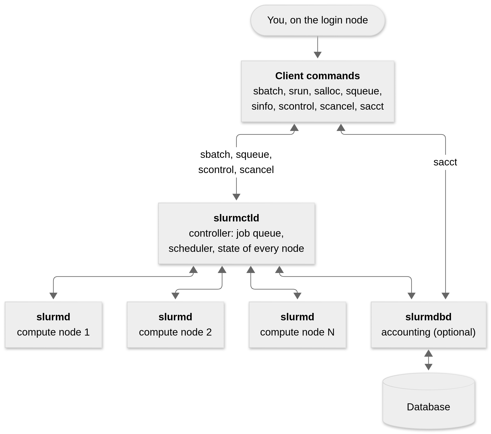
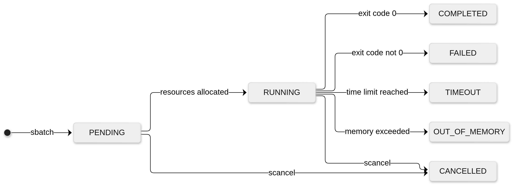
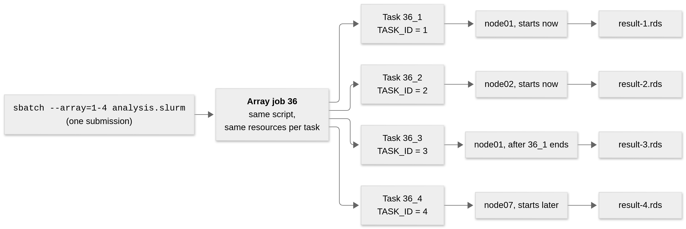
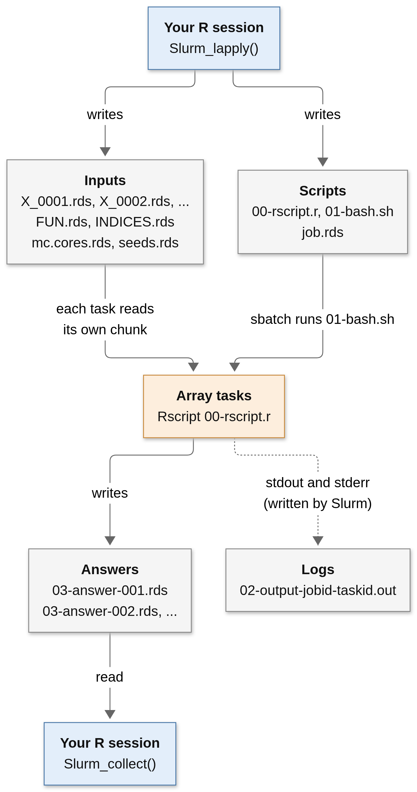
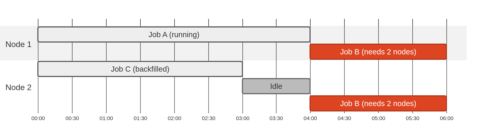

# Under the hood: Slurm and slurmR

::: {.callout-important title="AI-disclosure"}
This chapter was written almost entirely by Claude code. The author asked it to create a more detailed version of how Slurm and slurmR work. The contents have been checked and edited by the author, but the original draft was generated by AI. Furthermore, the AI used documenation from the slurmR package (written by the author) to explain how the package works.
:::

In the [previous chapter](slurm-fundamentals.qmd) we learned the vocabulary (nodes, partitions, tasks, CPUs) and submitted a "Hello world" with `sbatch`.
Before we start running real analyses in the [next chapter](slurm-simpi.qmd), it is worth spending a few minutes understanding what happens *after* you press enter.
When something goes wrong on a cluster (a job that never starts, a job that dies without a message, results that never show up), the answer almost always lies in one of the moving parts we describe here.

This chapter has two parts:

1.  **How Slurm works:** the processes that make up a Slurm cluster, the life of a job from submission to completion, how the scheduler decides what runs where, and what a **job array** is.

2.  **How slurmR works:** how the `slurmR` package uses job arrays to give you `parallel`-like functions (`Slurm_lapply()`, `Slurm_sapply()`, ...) that run on a cluster, including every file it creates along the way.

No code needs to be run to follow this chapter.
The only R output you will see comes from the package's "verbose mode," which prints what `slurmR` would do without submitting anything.

## How Slurm works

### The cast of characters

Slurm is a collection of programs that talk to each other over the network.
Some of them run all the time (called **daemons**, the `d` at the end of `slurmctld`, `slurmd`, and `slurmdbd`), and others are the commands you type.
@fig-slurm-components shows how they relate to each other, and @tbl-slurm-daemons describes each piece.

{#fig-slurm-components width=90%}

| Piece | Where it runs | What it does |
|:------|:--------------|:-------------|
| `slurmctld` | Management node | The "brain." It keeps the list of all nodes and their state, holds the queue of jobs, decides which job runs where and when, and tells the nodes what to do. There can be a backup controller in case this one fails. |
| `slurmd` | Every compute node | The "worker." It sits on a node waiting for instructions from `slurmctld`, starts the work, monitors it, reports back when it ends, and waits for more. It is often compared to a remote shell. |
| `slurmdbd` | Management node (optional) | Records accounting information (who ran what, for how long, using how much memory) in a database. This is where `sacct` gets its information. |
| Client commands | Login node (and compute nodes) | `sbatch` (submit a script), `srun` (run a command in an allocation), `salloc` (get an interactive allocation), `squeue` (list jobs), `sinfo` (list nodes and partitions), `scontrol` (inspect and modify), `scancel` (cancel), `sacct` (past jobs). |

: Components of Slurm. {#tbl-slurm-daemons}


An important consequence of this design is that **the login node is only a front door**. When you type `sbatch`, the command does not run your script: it sends a request to `slurmctld` and returns. Your script will run later, on one or more compute nodes, under the supervision of `slurmd`.

### Nodes, partitions, jobs, and job steps

In the previous chapter we defined nodes and partitions.
Slurm adds two more concepts on top of them: the **job** and the **job step**.

-   A **job** is a resource allocation: "give me these nodes/CPUs/memory for this long."
    Each job gets a unique job ID (the number `sbatch` prints after `Submitted batch job`).

-   A **job step** is a set of tasks launched *inside* a job, typically with `srun`.
    A job may have one step or many, running at the same time or one after another.

For example, one job may be allocated six nodes of a partition and run a single step that uses all of them, while another job splits its four nodes into two steps of two nodes each.
Nodes that don't belong to any job are free for other jobs to use.

For R users, the most common situation is simple: one batch script (the job) that calls `Rscript` once (so there is effectively one step).
Whatever parallelism you want *inside* that job (multiple cores with `mclapply()`, a socket cluster, etc.) is up to your R code.
**Slurm reserves the resources, it does not parallelize your program.**

### The life of a job

@fig-job-sequence follows a batch job from the moment you submit it to the moment it is recorded in the accounting database.

{#fig-job-sequence width=100%}

In words:

1.  **Submission.** `sbatch` reads your script, collects the `#SBATCH` options at the top (they are just comments for bash, but `sbatch` parses them), and sends everything to `slurmctld`.
    The controller checks that the request makes sense (does the partition exist? are you allowed to use that account? is the time limit allowed?), assigns a job ID, and puts the job in the queue.
    This is why `sbatch` returns immediately.

2.  **Waiting.** The job stays `PENDING` until the scheduler finds a place for it (see [How Slurm decides who runs where](#sec-slurm-scheduling) in the appendix of this chapter).
    The short version: ask for what you need, not much more (so the job fits in gaps and starts sooner) and not less (or Slurm kills it).

3.  **Allocation and launch.** When the resources are available, `slurmctld` marks them as yours, and asks the `slurmd` of the **first node of the allocation** to run your batch script.
    Slurm sets a number of environment variables before doing so (`SLURM_JOB_ID`, `SLURM_CPUS_PER_TASK`, `SLURMD_NODENAME`, `SLURM_ARRAY_TASK_ID`, ...), and everything the script prints to the standard output or standard error goes to the file specified in `--output` (by default `slurm-<jobid>.out` in the directory where you ran `sbatch`).

4.  **Running.** The script is a regular bash script: it runs commands one after another on that first node.
    If it calls `srun`, Slurm launches job steps on the allocated resources; if it just calls `Rscript`, a single R process starts on that node.

5.  **Completion.** When the script ends, or when something forces it to stop, `slurmd` reports back, the resources are released, and the job's final state and resource usage are recorded.

A job is always in one of a handful of states, which you see in the `ST` column of `squeue` and the `State` column of `sacct`.
@fig-job-states shows the most common ones, and @tbl-job-states lists their codes.

{#fig-job-states width=100%}

| State | `squeue` code | Meaning |
|:------|:--------------|:--------|
| `PENDING` | `PD` | Waiting for resources (or for a higher priority job to go first). |
| `RUNNING` | `R` | The job has an allocation and the script is running. |
| `COMPLETING` | `CG` | The script ended, and Slurm is cleaning up (some processes may still be active). |
| `COMPLETED` | `CD` | The script ended with exit code 0. |
| `FAILED` | `F` | The script ended with a non-zero exit code. |
| `CANCELLED` | `CA` | Someone (you or an admin) cancelled the job with `scancel`. |
| `TIMEOUT` | `TO` | The job reached the time limit (`--time`) and was killed. |
| `OUT_OF_MEMORY` | `OOM` | The job tried to use more memory than requested. |

: Common job states. {#tbl-job-states}

Notice that Slurm decides if a job succeeded based **only on the exit code of the batch script**.
Slurm knows nothing about whether your R code did what you wanted; if R exits normally, the job is `COMPLETED`.
We will see why this matters when we talk about error handling in `slurmR`.

### Job arrays

Many problems in statistics and data science look like this: *run the same program many times, changing only a small thing between runs.*
Simulating a model 1,000 times with different seeds, fitting the same model to 200 datasets, evaluating a grid of tuning parameters, or bootstrapping 5,000 replicates are all examples.
Each run is independent of the others, so they can all run at the same time.
These are known as *embarrassingly parallel* problems.

One way to handle this is to write a loop in R that goes over all the cases, and ask for many cores (what we did with `mclapply()` in the [parallel chapter](parallel-pkg.qmd)).
This works, but all the cores must come from a *single node*, so you are limited to the size of the largest node, and Slurm has to find one big gap in the cluster big enough for the whole job.
The other approach is to submit many small jobs, but typing `sbatch` a thousand times is clumsy, it floods the queue, and it makes the jobs harder to track.

A **job array** is Slurm's answer: you submit **one** script with **one** `sbatch` command and tell Slurm to create *N copies* of it.
Slurm treats each copy, called an **array task**, as an independent job: it has its own job ID, is scheduled independently (so one task may start right away on node 1, another a few minutes later on node 7, and a third one may wait until the evening), has its own allocation (the resources you requested apply *per task*, not to the array as a whole), and writes its own output file.
The only difference between the copies is a number, the **array index**, which Slurm makes available to each copy in the environment variable `SLURM_ARRAY_TASK_ID`.
It is up to your script to use that number to decide what to do: which seed to use, which row of a parameter table to evaluate, which chunk of the data to process, or which file to read.

@fig-job-array shows a job array with four tasks.

{#fig-job-array width=100%}

The size and the indices of the array are specified with the `--array` (or `-a`) option of `sbatch`:

| Option | Tasks created |
|:-------|:--------------|
| `--array=1-100` | 1, 2, ..., 100 |
| `--array=1,3,5,7` | 1, 3, 5, and 7 |
| `--array=1-7:2` | 1, 3, 5, and 7 (a range with a step of 2) |
| `--array=1-100%10` | 1, ..., 100, but no more than 10 running at the same time |

: Examples of the `--array` option. {#tbl-array-options}

The last one is handy when each task reads a large file or hits a shared resource (like a database), and you don't want 100 of them doing it at once.

Besides `SLURM_ARRAY_TASK_ID`, Slurm sets other variables in each task, and offers file name patterns to keep outputs from overwriting each other:

| What | Variable | In `--output` use | Example in task 2 of job 36 |
|:-----|:---------|:------------------|:----------------------------|
| ID of the array as a whole | `SLURM_ARRAY_JOB_ID` | `%A` | `36` |
| Index of this task | `SLURM_ARRAY_TASK_ID` | `%a` | `2` |
| ID of this task as a regular job | `SLURM_JOB_ID` | `%j` | `37` |
| Number of tasks in the array | `SLURM_ARRAY_TASK_COUNT` | | `4` |

: Environment variables and file name patterns of job arrays. {#tbl-array-vars}

Slurm also lets you refer to a single task as `<array job id>_<task index>` (e.g., `36_2`), which you can use with `squeue`, `sacct`, `scontrol`, and `scancel`.
Cancelling `36_2` stops only that task; cancelling `36` stops them all.

From R, using the index looks like this.
Suppose we want to evaluate a model over a grid of six parameter combinations, one per task.
The R script (`array-example.R`) reads its own index and picks its row:

```r
# Each array task gets a different value of SLURM_ARRAY_TASK_ID
id <- as.integer(Sys.getenv("SLURM_ARRAY_TASK_ID"))

# All tasks build the same grid, but each takes a different row
grid <- expand.grid(
  n   = c(100, 1000),
  rho = c(0.1, 0.5, 0.9)
)
params <- grid[id, ]

set.seed(id) # A different seed per task
res <- my_simulation(n = params$n, rho = params$rho)

# Each task saves its own file
saveRDS(res, sprintf("result-%03d.rds", id))
```

and the bash script that submits it (six tasks, one core each) is

```bash
#!/bin/sh
#SBATCH --job-name=array-example
#SBATCH --output=array-example-%A-%a.out
#SBATCH --array=1-6
#SBATCH --cpus-per-task=1
#SBATCH --time=00:30:00
module load R/4.2.2
Rscript array-example.R
```

One `sbatch array-example.slurm` creates six jobs, each of which produces its own `result-00X.rds` and its own log `array-example-<jobid>-<X>.out`.

Job arrays also have a few advantages that make them the preferred tool for this kind of work:

-   **Scale.** The tasks can be spread over many nodes, so the limit is the cluster size (and the administrators' limits), not the size of one node.

-   **Faster scheduling.** Smaller jobs fit more easily in the scheduler's gaps (see [backfill](#sec-slurm-scheduling)), and Slurm handles a whole array as a single submission instead of thousands.

-   **Failures are contained.** If task 17 runs out of memory, the other 99 are not affected, and you can rerun only the task that failed with, e.g., `sbatch --array=17 analysis.slurm`.

-   **Easy bookkeeping.** One job ID identifies the whole group, and each task's output is in its own file.

@tbl-parallel-flavors compares job arrays with the other ways of getting more than one CPU that we have seen so far.

| Strategy | Where does it run? | Who creates the parallelism? |
|:---------|:-------------------|:-----------------------------|
| **Multicore job** (`--cpus-per-task=8`) | One job, on one node, with 8 cores | Your R code (`mclapply()`, `parLapply()`) |
| **Multi-task job** (`--ntasks=8`) | One job, possibly on several nodes | Your R code (e.g., a socket or MPI cluster) |
| **Job array** (`--array=1-8`) | 8 independent jobs, anywhere in the cluster | Slurm; your script only uses the index |

: Three ways of using more than one CPU. {#tbl-parallel-flavors}

The `slurmR` package builds its `Slurm_lapply()` family of functions on top of job arrays, as we will see in the next part.
For more details on job arrays, see the [official documentation](https://slurm.schedmd.com/job_array.html){target="_blank"}.

## How slurmR works

### The idea

The `slurmR` package [@slurmRpaper; @slurmRpkg] is a lightweight wrapper around Slurm.
Its design goal is to let you move from the `parallel` package to a cluster without learning to write Slurm scripts: just as `parallel` provides `parLapply()`, `parSapply()`, and `clusterMap()`, `slurmR` provides `Slurm_lapply()`, `Slurm_sapply()`, and `Slurm_Map()`.
There is also `Slurm_EvalQ()`, which evaluates an expression in every job (like `clusterEvalQ()`), and `makeSlurmCluster()`, which creates a socket cluster out of a Slurm allocation (we use it in the [next chapter](slurm-simpi.qmd)).

The `Slurm_*apply` functions work like this: you hand over a list `X` and a function `FUN`; `slurmR` splits the list in `njobs` chunks, creates a job array with `njobs` tasks, and each task applies `FUN` to its chunk (using `mclapply()`, so each task can use several cores too).
When all tasks are done, it puts the pieces back together.
The result is the same as what `lapply(X, FUN)` would have returned, but the computation happened in as many different jobs as you wanted.

Everything is done by writing files.
**Every call to `Slurm_lapply()` creates, at least, two scripts: an R script with the work each array task has to do, and a bash script with the `sbatch` options that submits it.**
The data and the function are saved to disk (as `.rds` files) so that the tasks, which run on other computers, can read them.
For this reason, the folder where `slurmR` writes must be visible from the compute nodes: a shared file system.

### A job's journey

In short, a call like `Slurm_lapply(X, FUN, njobs = 2)` goes through the following steps.
In your R session, `slurmR` splits `X` in `njobs` chunks, saves the chunks, the function, and the options in the job folder, writes the two scripts (`00-rscript.r` and `01-bash.sh`), and runs `sbatch 01-bash.sh`.
Slurm then queues a job array (`--array=1-njobs`), and each array task runs `Rscript 00-rscript.r`: it reads its own chunk, computes, and saves its answer in `03-answer-<id>.rds`.
Meanwhile, your R session polls Slurm until all tasks have finished, `Slurm_collect()` reads and combines the answers, and, when you no longer need them, `Slurm_clean()` deletes the job folder.

The next sections go through each of these steps, using the package's verbose mode to see exactly what is created.
A [timeline of the whole process](#sec-slurmr-timeline) is included in the appendix of this chapter.

### Looking under the hood

The following example is from the package's README (@slurmRpkg).
We create 100 vectors of 50 random numbers each, and we want to compute the mean of each of them using `Slurm_lapply()`:

```r
library(slurmR)
#  Loading required package: parallel
#  slurmR default option for `tmp_path` (used to store auxiliar files) set to:
#    /home/user/project
#  You can change this and checkout other slurmR options using: ?opts_slurmR, or you could just type "opts_slurmR" on the terminal.

# Suppose that we have 100 vectors of length 50 ~ Unif(0,1)
set.seed(881)
x <- replicate(100, runif(50), simplify = FALSE)
```

The argument `plan = "none"` tells `Slurm_lapply()` to *create* the job but not to submit it, so we can look at what it produces without needing a cluster.
By turning the verbose mode on, `slurmR` prints the contents of the two scripts it writes:

```r
opts_slurmR$verbose_on()
ans <- Slurm_lapply(x, mean, plan = "none")
```

::: {.callout-note collapse="true"}
## Full verbose output (click to expand)

The output is reproduced as in the package's README, except that the author's home directory was replaced with `/home/user`.
We also omit a harmless `normalizePath` warning that `slurmR` prints because the job folder does not exist at the moment it checks the path.

```
--------------------------------------------------------------------------------
[VERBOSE MODE ON] The R script that will be used is located at: /home/user/project/slurmr-job-113bd5bca5b18/00-rscript.r and has the following contents:
--------------------------------------------------------------------------------
.libPaths(c("/home/user/R/x86_64-pc-linux-gnu-library/4.2", "/usr/local/lib/R/site-library", "/usr/lib/R/site-library", "/usr/lib/R/library"))
message("[slurmR info] Loading variables and functions... ", appendLF = FALSE)
Slurm_env <- function (x = "SLURM_ARRAY_TASK_ID") 
{
    y <- Sys.getenv(x)
    if ((x == "SLURM_ARRAY_TASK_ID") && y == "") {
        return(1)
    }
    y
}
ARRAY_ID  <- as.integer(Slurm_env("SLURM_ARRAY_TASK_ID"))

# The -snames- function creates the write names for I/O of files as a 
# function of the ARRAY_ID
snames    <- function (type, array_id = NULL, tmp_path = NULL, job_name = NULL) 
{
    if (length(array_id) && length(array_id) > 1) 
        return(sapply(array_id, snames, type = type, tmp_path = tmp_path, 
            job_name = job_name))
    type <- switch(type, r = "00-rscript.r", sh = "01-bash.sh", 
        out = "02-output-%A-%a.out", rds = if (missing(array_id)) "03-answer-%03i.rds" else sprintf("03-answer-%03i.rds", 
            array_id), job = "job.rds", stop("Invalid type, the only valid types are `r`, `sh`, `out`, and `rds`.", 
            call. = FALSE))
    sprintf("%s/%s/%s", tmp_path, job_name, type)
}
TMP_PATH  <- "/home/user/project"
JOB_NAME  <- "slurmr-job-113bd5bca5b18"

# The -tcq- function is a wrapper of tryCatch that on error tries to recover
# the message and saves the outcome so that slurmR can return OK.
tcq <- function (...) 
{
    ans <- tryCatch(..., error = function(e) e)
    if (inherits(ans, "error")) {
        ARRAY_ID. <- get("ARRAY_ID", envir = .GlobalEnv)
        msg <- paste0("[slurmR info] An error has ocurred while evualting the expression:\n[slurmR info]   ", 
            paste(deparse(match.call()[[2]]), collapse = "\n[slurmR info]   "), 
            "\n[slurmR info] in ", "ARRAY_ID # ", ARRAY_ID., 
            "\n[slurmR info] The error will be saved and quit R.\n")
        message(msg, immediate. = TRUE, call. = FALSE)
        ans <- list(res = ans, array_id = ARRAY_ID., job_name = get("JOB_NAME", 
            envir = .GlobalEnv), slurmr_msg = structure(msg, 
            class = "slurm_info"))
        saveRDS(list(ans), snames("rds", tmp_path = get("TMP_PATH", 
            envir = .GlobalEnv), job_name = get("JOB_NAME", envir = .GlobalEnv), 
            array_id = ARRAY_ID.))
        message("[slurmR info] job-status: failed.\n")
        q(save = "no")
    }
    invisible(ans)
}
message("done loading variables and functions.")
tcq({
  INDICES <- readRDS("/home/user/project/slurmr-job-113bd5bca5b18/INDICES.rds")
})
tcq({
  X <- readRDS(sprintf("/home/user/project/slurmr-job-113bd5bca5b18/X_%04d.rds", ARRAY_ID))
})
tcq({
  FUN <- readRDS("/home/user/project/slurmr-job-113bd5bca5b18/FUN.rds")
})
tcq({
  mc.cores <- readRDS("/home/user/project/slurmr-job-113bd5bca5b18/mc.cores.rds")
})
tcq({
  seeds <- readRDS("/home/user/project/slurmr-job-113bd5bca5b18/seeds.rds")
})
set.seed(seeds[ARRAY_ID], kind = NULL, normal.kind = NULL)
tcq({
  ans <- parallel::mclapply(
    X                = X,
    FUN              = FUN,
    mc.cores         = mc.cores
)
})
saveRDS(ans, sprintf("/home/user/project/slurmr-job-113bd5bca5b18/03-answer-%03i.rds", ARRAY_ID), compress = TRUE)
message("[slurmR info] job-status: OK.\n")
--------------------------------------------------------------------------------
The bash file that will be used is located at: /home/user/project/slurmr-job-113bd5bca5b18/01-bash.sh and has the following contents:
--------------------------------------------------------------------------------
#!/bin/sh
#SBATCH --job-name=slurmr-job-113bd5bca5b18
#SBATCH --output=/home/user/project/slurmr-job-113bd5bca5b18/02-output-%A-%a.out
#SBATCH --array=1-2
#SBATCH --job-name=slurmr-job-113bd5bca5b18
#SBATCH --cpus-per-task=1
#SBATCH --ntasks=1
/usr/lib/R/bin/Rscript  /home/user/project/slurmr-job-113bd5bca5b18/00-rscript.r
--------------------------------------------------------------------------------
EOF
--------------------------------------------------------------------------------
Warning: [submit = FALSE] The job hasn't been submitted yet. Use sbatch() to submit the job, or you can submit it via command line using the following:
sbatch --job-name=slurmr-job-113bd5bca5b18 /home/user/project/slurmr-job-113bd5bca5b18/01-bash.sh
```
:::

The output has three parts: the R script (`00-rscript.r`), the bash script (`01-bash.sh`), and a final warning reminding us that the job has not been submitted and giving the command to submit it manually.
The next sections explain each.

::: {.callout-tip}
The call above did not submit anything but it **did** write files to disk, so you can inspect them.
Once you are done looking, `Slurm_clean(ans)` removes them.
:::

### Where everything lives: the job folder

Each call creates its own folder, which `slurmR` calls the **temporary path** of the job.
The name of the folder is controlled by two options:

-   `tmp_path`: the directory where job folders are created.
    By default it is the **current working directory** of your R session (the message you get when you load the package tells you the current value).
    You can change it for a single call with the `tmp_path` argument, or for the whole session with `opts_slurmR$set_tmp_path()`.

-   `job_name`: the name of the folder (and of the Slurm job).
    By default it is a random name such as `slurmr-job-113bd5bca5b18`, so two calls never collide.

The files of a job end up in `<tmp_path>/<job_name>/`.
For the example above, using two jobs, the folder looks like this once the job has run:

```
slurmr-job-113bd5bca5b18/
├── 00-rscript.r          # the R script each array task runs
├── 01-bash.sh            # the bash script submitted with sbatch
├── 02-output-<jobid>-1.out   # log of task 1  (created by Slurm)
├── 02-output-<jobid>-2.out   # log of task 2  (created by Slurm)
├── 03-answer-001.rds     # result of task 1  (created by the tasks)
├── 03-answer-002.rds     # result of task 2  (created by the tasks)
├── FUN.rds               # the function, shared by all tasks
├── INDICES.rds           # which elements of X went to which task
├── job.rds               # the slurm_job object (job ID, options, ...)
├── mc.cores.rds          # number of cores per task
├── seeds.rds             # one random seed per task
├── X_0001.rds            # chunk of X for task 1
└── X_0002.rds            # chunk of X for task 2
```

The files created *before* submission (`00`, `01`, `FUN`, `INDICES`, `job`, `mc.cores`, `seeds`, and the `X_*` chunks) are written by your R session.
The `02-output-*` and `03-answer-*` files appear only after the tasks run.
@tbl-slurmr-files describes each of them.

| File | Created by | Description |
|:-----|:-----------|:------------|
| `00-rscript.r` | Your R session | The R script that every array task runs. The same script is used by all tasks; the tasks differ by the value of `SLURM_ARRAY_TASK_ID`. |
| `01-bash.sh` | Your R session | The bash script passed to `sbatch`, with the `#SBATCH` options. It calls `Rscript 00-rscript.r`. |
| `X_0001.rds`, `X_0002.rds`, ... | Your R session | The list `X` split in `njobs` chunks, one file per task (by default `parallel::splitIndices()` makes consecutive, equally sized chunks). Each task reads only its own chunk. |
| `INDICES.rds` | Your R session | A list that records which elements of `X` went to each task, which allows putting the results in the right order. |
| `FUN.rds` | Your R session | The function to apply. Any other argument passed through `...` or `export` is saved here too (as `.rds` files) and is shared by all tasks. |
| `mc.cores.rds` | Your R session | The number of cores each task uses with `mclapply()`. |
| `seeds.rds` | Your R session | A vector of random seeds, one per task, so that tasks don't generate the same random numbers (you can provide your own with the `seeds` argument). |
| `job.rds` | Your R session | The `slurm_job` object: the call, the options, the paths, and (after submission) the job ID. It is saved when the job is created and again after it is submitted. |
| `02-output-<jobid>-<taskid>.out` | Slurm | The **log**: everything the task printed to the standard output and standard error, including `slurmR`'s own messages (`[slurmR info] ...`) and any R error. One file per task. |
| `03-answer-001.rds`, `03-answer-002.rds`, ... | The array tasks | The **results**: the value returned by `mclapply(X, FUN)` for the chunk, one file per task. |

: Files in the job folder. {#tbl-slurmr-files}

@fig-slurmr-files shows who writes and who reads each file.

{#fig-slurmr-files width=55%}

::: {.callout-important}
## The job folder must be visible from the compute nodes

The login node and the compute nodes must see the same files at the same path.
Home directories and project or scratch spaces usually satisfy this, but local disks (like `/tmp` or a node-local scratch) do not: a file written to `/tmp` on the login node doesn't exist on the node where the task runs, and the task will fail while reading its input.
If in doubt, ask your system administrators which file system to use, and set `tmp_path` accordingly.
:::

::: {.callout-warning}
## Reusing a job name erases the previous job

By default `overwrite = TRUE`, which means that if `<tmp_path>/<job_name>` already exists, **`slurmR` deletes it and starts from scratch**.
This is not a problem with the default random names, but if you set `job_name` yourself, running the same call twice destroys the results of the first one.
Use `overwrite = FALSE` if you want `slurmR` to stop instead.
:::

### The bash script

This is the bash script generated in the example (`01-bash.sh`):

```bash
#!/bin/sh
#SBATCH --job-name=slurmr-job-113bd5bca5b18
#SBATCH --output=/home/user/project/slurmr-job-113bd5bca5b18/02-output-%A-%a.out
#SBATCH --array=1-2
#SBATCH --job-name=slurmr-job-113bd5bca5b18
#SBATCH --cpus-per-task=1
#SBATCH --ntasks=1
/usr/lib/R/bin/Rscript  /home/user/project/slurmr-job-113bd5bca5b18/00-rscript.r
```

It is a regular Slurm script like the ones in the previous chapters:

-   `--job-name` is the job's name, `slurmr-job-` followed by random characters (it appears twice because it is added both by the function and by the options; the repetition is harmless).

-   `--output` sends the log to the job folder, using the patterns we saw in @tbl-array-vars: `%A` becomes the ID of the array and `%a` the index of the task. This is how the `02-output-<jobid>-<taskid>.out` files get their names.

-   `--array=1-2` creates a job array with `njobs` tasks (the default is `njobs = 2`).

-   `--cpus-per-task` is taken from the `mc.cores` argument, and `--ntasks=1` because each array task is a single R process.

-   The last line calls `Rscript` (from the same R installation as your current session) on the R script.

You can add anything else the script needs by using the arguments of `Slurm_lapply()`:

-   `sbatch_opt`: a named list of options, each of them becomes an `#SBATCH --name=value` line.

-   `preamble`: commands to run before `Rscript`, such as `module load`. The preamble can be set for the whole session with `opts_slurmR$set_preamble()`.

-   `rscript_opt`: options passed to `Rscript`.

For example, the call

```r
job <- Slurm_lapply(
  x, mean,
  njobs      = 4,
  mc.cores   = 2,
  plan       = "none",
  job_name   = "my-means",
  sbatch_opt = list(
    account       = "my-account",
    partition     = "my-partition",
    time          = "01:00:00",
    `mem-per-cpu` = "2G"
  ),
  preamble   = "module load gcc/12.2.0"
)
```

generates the following bash script:

```bash
#!/bin/sh
#SBATCH --job-name=my-means
#SBATCH --output=/home/user/project/my-means/02-output-%A-%a.out
#SBATCH --array=1-4
#SBATCH --account=my-account
#SBATCH --partition=my-partition
#SBATCH --time=01:00:00
#SBATCH --mem-per-cpu=2G
#SBATCH --job-name=my-means
#SBATCH --cpus-per-task=2
#SBATCH --ntasks=1
module load gcc/12.2.0
/usr/lib/R/bin/Rscript  /home/user/project/my-means/00-rscript.r
```

Remember that, as we saw with job arrays, **these resources are per task**: the example above asks for four tasks with two CPUs each, one hour and 2 GB of memory per CPU *each*.

::: {.callout-note}
## Don't use the preamble to load R
`slurmR` calls `Rscript` using the full path of the R installation of your *current* session (see the last line of the script), and it also copies your library paths (more on that below).
Loading a different R with `module load R/...` in the preamble therefore has no effect on which R runs the tasks.
Use the preamble for everything *else* the tasks need, such as a compiler or a system library (in the example, `gcc`); if you need another version of R, start your R session with that version.
:::

### The R script

The second file is the R script that every array task runs.
It is long because `slurmR` writes it in a self-contained way (it does not even load `slurmR`: all the helper functions it needs are defined in the script itself).
It can be read as five blocks:

**1. Setup.**
The script sets the library paths to be the same as in your session, so the tasks find the same packages, and finds out which task it is by reading `SLURM_ARRAY_TASK_ID`:

```r
.libPaths(c("/home/user/R/x86_64-pc-linux-gnu-library/4.2", "/usr/local/lib/R/site-library", "/usr/lib/R/site-library", "/usr/lib/R/library"))
message("[slurmR info] Loading variables and functions... ", appendLF = FALSE)
Slurm_env <- function (x = "SLURM_ARRAY_TASK_ID")
{
    y <- Sys.getenv(x)
    if ((x == "SLURM_ARRAY_TASK_ID") && y == "") {
        return(1)
    }
    y
}
ARRAY_ID  <- as.integer(Slurm_env("SLURM_ARRAY_TASK_ID"))
```

If the script is run outside of Slurm (where the variable is empty) the ID defaults to 1, which allows testing the script by hand.
It also defines `snames()`, a helper that builds the file names (`00-rscript.r`, `03-answer-%03i.rds`, etc.) from the task ID, and stores the path and name of the job in `TMP_PATH` and `JOB_NAME`.

**2. Error handling.**
Each step that could fail is wrapped in `tcq()` (short for "tryCatch quietly").
This is the function that deals with errors:

```r
tcq <- function (...)
{
    ans <- tryCatch(..., error = function(e) e)
    if (inherits(ans, "error")) {
        ARRAY_ID. <- get("ARRAY_ID", envir = .GlobalEnv)
        msg <- paste0("[slurmR info] An error has ocurred while evualting the expression:\n[slurmR info]   ",
            paste(deparse(match.call()[[2]]), collapse = "\n[slurmR info]   "),
            "\n[slurmR info] in ", "ARRAY_ID # ", ARRAY_ID.,
            "\n[slurmR info] The error will be saved and quit R.\n")
        message(msg, immediate. = TRUE, call. = FALSE)
        ans <- list(res = ans, array_id = ARRAY_ID., job_name = get("JOB_NAME",
            envir = .GlobalEnv), slurmr_msg = structure(msg, class = "slurm_info"))
        saveRDS(list(ans), snames("rds", tmp_path = get("TMP_PATH", envir = .GlobalEnv),
            job_name = get("JOB_NAME", envir = .GlobalEnv), array_id = ARRAY_ID.))
        message("[slurmR info] job-status: failed.\n")
        q(save = "no")
    }
    invisible(ans)
}
```

If an error happens, `tcq()` prints a message to the log, **saves the error in the task's answer file** (`03-answer-<id>.rds`) instead of the results, and quits R.
Since `q()` exits with status 0, Slurm will consider the task as `COMPLETED` even though your function failed.
The place to look for the problem is the log (`[slurmR info] job-status: failed.`).

**3. Reading the inputs.**
Each task loads the objects it needs; notice that `X_%04d.rds` is formatted with `ARRAY_ID`, so **each task reads only its own chunk**:

```r
tcq({
  INDICES <- readRDS("/home/user/project/slurmr-job-113bd5bca5b18/INDICES.rds")
})
tcq({
  X <- readRDS(sprintf("/home/user/project/slurmr-job-113bd5bca5b18/X_%04d.rds", ARRAY_ID))
})
tcq({
  FUN <- readRDS("/home/user/project/slurmr-job-113bd5bca5b18/FUN.rds")
})
tcq({
  mc.cores <- readRDS("/home/user/project/slurmr-job-113bd5bca5b18/mc.cores.rds")
})
tcq({
  seeds <- readRDS("/home/user/project/slurmr-job-113bd5bca5b18/seeds.rds")
})
```

**4. The computation.**
The task sets its seed (`seeds[ARRAY_ID]`) and applies the function to its chunk with `parallel::mclapply()`:

```r
set.seed(seeds[ARRAY_ID], kind = NULL, normal.kind = NULL)
tcq({
  ans <- parallel::mclapply(
    X                = X,
    FUN              = FUN,
    mc.cores         = mc.cores
)
})
```

**5. Saving the answer.**
The result is saved in `03-answer-<id>.rds`, and a final message is printed to the log:

```r
saveRDS(ans, sprintf("/home/user/project/slurmr-job-113bd5bca5b18/03-answer-%03i.rds", ARRAY_ID), compress = TRUE)
message("[slurmR info] job-status: OK.\n")
```

@fig-slurmr-task summarizes what each array task does.

{#fig-slurmr-task width=65%}

### Submitting, monitoring, and logs

With the default `plan = "collect"`, `Slurm_lapply()` writes the files, submits the job, waits for it, and collects the answers in a single call.
`slurmR` submits the job by running `sbatch` and reading the job ID that Slurm prints (`Submitted batch job 4242`), then stores it in the `slurm_job` object (and in `job.rds`).
After that it *waits*: it repeatedly asks Slurm for the state of the tasks (using `sacct`) until all of them have finished, either successfully or with a failure.
How much of this happens in one call is controlled by the `plan` argument:

| `plan` | What `Slurm_lapply()` does | Returns |
|:-------|:---------------------------|:--------|
| `"none"` | Writes the files only. Nothing is submitted. | The `slurm_job` object |
| `"submit"` | Writes the files and submits the job, then returns right away. | The `slurm_job` object |
| `"wait"` | Writes, submits, and waits until all tasks have finished. | The `slurm_job` object |
| `"collect"` (default) | Writes, submits, waits, and collects the answers. | The results (a list) |

: The `plan` argument of `Slurm_lapply()` and friends. {#tbl-plans}

::: {.callout-note}
With `plan = "collect"` or `"wait"` your R session is busy until the whole job ends, so if the session is closed (or you lose your connection to the cluster), you lose the connection to the job.
The job itself keeps running, though.
For long jobs, use `plan = "submit"`, and come back later: `read_slurm_job("<tmp_path>/<job_name>")` reads the `job.rds` file and gives you back the `slurm_job` object in a new R session, and `last_job()` returns the last job submitted in the current session.
:::

Once you have a `slurm_job` object (call it `job`), you can interact with it using the following functions, which are thin wrappers of the corresponding Slurm commands:

| Function | Equivalent to | What it does |
|:---------|:--------------|:-------------|
| `status(job)` | `sacct` | A summary of the state of the tasks: `0` all done, `1` all pending, `2` all running, `3` some running, `99` some failed, `-1` job not found (yet). |
| `squeue(job)` | `squeue` | Pending and running tasks. |
| `sacct(job)` | `sacct` | Information about finished (and unfinished) tasks. |
| `Slurm_log(job, 1)` | `less 02-output-<jobid>-1.out` | Shows the log of task 1. |
| `scancel(job)` | `scancel` | Cancels the job. |
| `sbatch(job)` | `sbatch` | (Re)submits the job. |

: Functions for working with a job. {#tbl-slurmr-monitor}

The logs (`02-output-*.out`) are where you should look first when something doesn't work.
(`Slurm_log()` shows them.) They contain anything your function printed with `print()` or `message()`, the `[slurmR info]` messages, R warnings and errors, and errors from Slurm itself (like exceeding the memory).
A healthy task ends with:

```
[slurmR info] Loading variables and functions... done loading variables and functions.
[slurmR info] job-status: OK.
```

### Collecting the results and cleaning up

When all tasks have finished, `Slurm_collect(job)` reads the `03-answer-001.rds`, ..., `03-answer-<njobs>.rds` files, in order, and concatenates them into a single list.
Since `X` was split in consecutive chunks, the concatenation puts the results in the same order as the elements of `X`, so `Slurm_lapply(x, mean)` returns what `lapply(x, mean)` would.
`Slurm_sapply()` additionally simplifies the collected list (with `simplify2array()`, as `sapply()` does).

`Slurm_collect()` is picky: if any task is still pending or running, or if one has failed, it stops with the error `Nothing to retrieve`.
Using `any. = TRUE` makes it read whatever answer files do exist, which is useful to take a look at partial results.

This is also where the job array design pays off.
Suppose tasks 1, 2, and 15 to 20 of a 20-task job failed (say, they went over the time limit).
You don't need to run everything again, just those tasks:

```r
# Submitting a simple job
job <- Slurm_EvalQ(slurmR::WhoAmI(), njobs = 20, plan = "submit")

# Checking the status of the job (we can simply print)
job
status(job)
sacct(job)

# Suppose some of the tasks are taking too long to complete (1, 2, and 15 through 20)
# we can stop them and resubmit only those as follows:
scancel(job)
sbatch(job, array = "1,2,15-20") # A new job ID will be assigned

# Once it's done, we can collect all the results at once
res <- Slurm_collect(job)

# And clean up if we don't need to use it again
Slurm_clean(job)
```

(This example was adapted from the package's manual.)
Because the inputs (`X_*.rds`, `FUN.rds`, ...) are still in the job folder, `sbatch(job, array = ...)` just submits the same bash script again, restricted to the selected tasks.

The job folder is **not** removed automatically after collecting, so you can collect again later or look at the logs.
When you don't need it anymore, `Slurm_clean(job)` deletes the whole folder (it refuses to do so if tasks are still pending or running).

::: {.callout-tip}
If you used `plan = "collect"`, the function returned the results, not the job object.
You can get the job back with `last_job()`, e.g., `Slurm_clean(last_job())`.
:::

### Other functions of the package

Two other functions of the package work differently, and we will see them in the next chapter:

-   `makeSlurmCluster()` submits a *single* job requesting several tasks, starts R worker processes on them, and connects to them from your session through sockets, like `parallel::makePSOCKcluster()`.
    This is not a job array.

-   `sourceSlurm()` lets you skip writing the bash script: you put the `#SBATCH` options at the top of an R script, and `slurmR` creates the bash file and submits it.

With this picture in mind, we are ready to run some code on the cluster.

## How Slurm decides who runs where {#sec-slurm-scheduling .appendix}

A cluster has many users and limited resources, so jobs usually have to wait.
The **scheduler** (part of `slurmctld`) continuously looks at the queue and decides what to start next.
The details are configured by each site, but the general idea has two ingredients:

-   **Priority.** Each pending job gets a priority number computed from several factors: how long it has been waiting (age), how much of the cluster you and your group have used recently (*fair share*: heavy users go back in the line for a while), the size of the job, the partition, and the quality of service (QOS) it was submitted under.
    Higher priority jobs are considered first.

-   **Backfill.** If the highest priority job needs resources that are not free yet (say, two whole nodes) the scheduler doesn't leave the free resources idle.
    It looks for lower priority jobs that can run in the meantime **without delaying the start of the higher priority job**.
    To do so, it relies on the time limit each job declared with `--time`.

@fig-backfill illustrates backfill in a two-node cluster.
Job A is running on node 1 for four hours.
Job B has the highest priority in the queue, but needs both nodes, so it must wait for A to finish.
Node 2 is idle in the meantime, and job C (low priority, needs one node for three hours) fits in the gap and finishes before B is scheduled to begin, so it is started right away.

{#fig-backfill width=100%}

This has two practical implications for you:

1.  **Ask for what you need, not for much more.**
    Requests with shorter time limits, fewer CPUs, or less memory are easier to fit in the gaps, so they tend to start sooner.

2.  **...but not for less.**
    If you ask for one hour and your job needs two, Slurm kills it at the one-hour mark (`TIMEOUT`).
    The same goes for memory (`OUT_OF_MEMORY`).
    Estimate your needs by running a small version of the job first (see the [profiling chapter](profiling.qmd)), and look at the report of finished jobs with `sacct`.

## Putting it all together: a `Slurm_lapply()` timeline {#sec-slurmr-timeline .appendix}

@fig-slurmr-timeline puts the whole story in a single timeline.

{#fig-slurmr-timeline width=100%}

<!--
TODO / polish notes (left as-is on purpose, to continue later):
- The last redesign of the diagrams (fig-slurmr-files,
  fig-slurmr-timeline; fig-slurmr-workflow was removed in favor of a
  paragraph) and the two simplified tables (tbl-plans,
  tbl-parallel-flavors) were rendered but NOT visually checked yet.
- fig-backfill and fig-slurmr-timeline now live in the chapter appendix
  (`## ... {.appendix}` sections at the end of the file); check they render
  correctly in HTML and in the PDF.
- fig-slurm-components layout is OK but a bit awkward (curvy edges).
- Mermaid theme is set to `neutral` in the front matter; the default theme
  made subgraph backgrounds dark grey with unreadable text.
- Diagrams are mermaid sources in fig/slurm-under-the-hood/{en,es}/*.mmd,
  rendered to PNG with `make diagrams` (mermaid.ink) and included as images,
  so the PDF build doesn't need a headless browser. Edit the .mmd, then run
  `make diagrams` and commit both files.
- Spanish version (es/slurm-under-the-hood.qmd) was machine-translated and
  has not been reviewed yet.
- slurmR README Example 2 calls `Slurm_clean(res)` on the collected list, which
  fails ("no applicable method for 'get_tmp_path'"); this chapter uses
  `Slurm_clean(job)` instead. Worth fixing upstream.
- Verbose output is the README's, with /home/george replaced by /home/user.
-->
